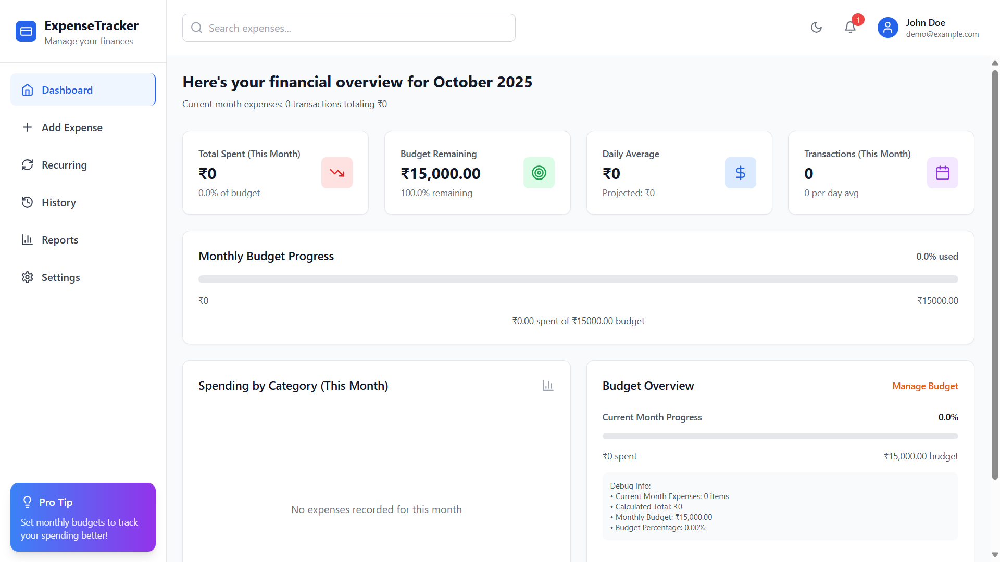
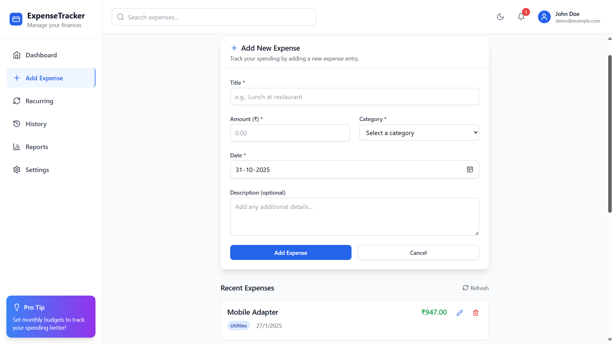
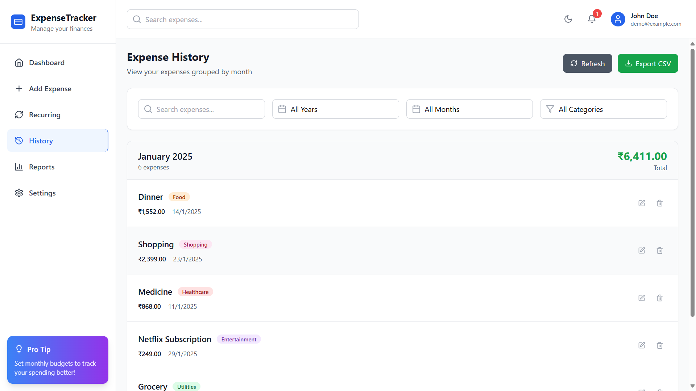
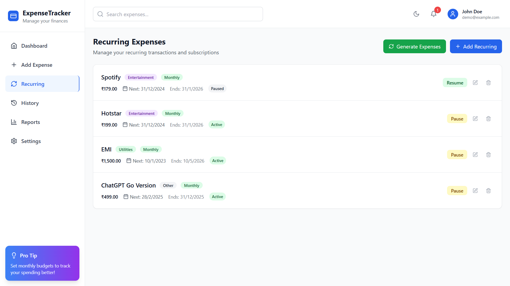
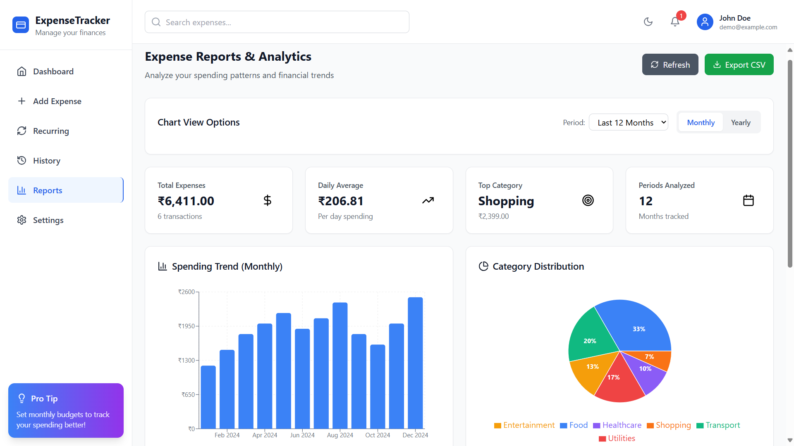
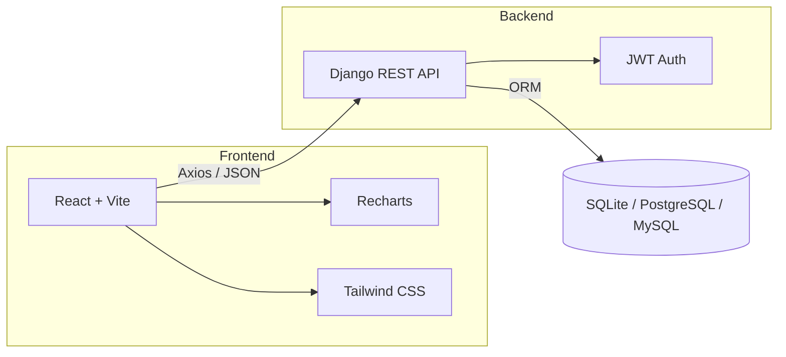

<div align="center">

# 💸 Expense Tracker

### A full-stack personal finance dashboard to record, categorize, and visualize your spending.

[](./LICENSE)
[](https://react.dev/)
[](https://www.typescriptlang.org/)
[](https://vitejs.dev/)
[](https://tailwindcss.com/)
[](https://www.djangoproject.com/)
[](https://www.django-rest-framework.org/)
[](https://www.python.org/)

[Features](#-features) · [Screenshots](#-screenshots) · [Tech Stack](#-tech-stack) · [Getting Started](#-getting-started) · [Roadmap](#-roadmap) · [Author](#-author)

</div>

---

## 📖 Overview

**Expense Tracker** is a full-stack web app that helps you understand where your money goes. Log expenses in seconds, organize them by category, track recurring payments, and explore your spending through interactive charts and reports.

The **React + TypeScript** frontend talks to a **Django REST Framework** backend over a JWT-secured API, so every user's data stays private to their own account.

**What you can do with it**

- Know exactly where your money goes each month
- Keep track of subscriptions and other recurring payments
- Spot spending trends with interactive visualizations
- Back up or migrate your data with CSV import/export

---

## ✨ Features

| Feature | Description |
| --- | --- |
| 🔐 **JWT Authentication** | Secure register/login with protected API endpoints (DRF Simple JWT). |
| 🧾 **Expense CRUD** | Add, edit, delete, and search expenses with notes. |
| 🏷️ **Categories & Tags** | Organize spending by category and keyword. |
| 🔁 **Recurring Payments** | Manage periodic expenses — daily, weekly, monthly, or yearly. |
| 📊 **Dashboard & Analytics** | At-a-glance summaries, trends, and category breakdowns. |
| 📈 **Interactive Charts** | Monthly and category-wise spending visualized with Recharts. |
| 📑 **Reports & History** | Filterable, searchable transaction history and detailed reports. |
| 📂 **CSV Import / Export** | Move your data in and out easily (powered by PapaParse). |
| 📱 **Responsive UI** | Clean, mobile-friendly layout built with Tailwind CSS. |
| 🛟 **Graceful Fallback** | If the backend is unreachable, selected features fall back to local storage for demos. |

---

## 🖼️ Screenshots

<table>
  <tr>
    <td align="center"><b>Dashboard</b><br/><sub>At-a-glance overview of spending</sub><br/></td>
    <td align="center"><b>Add Expenses</b><br/><sub>Fast input with categories and notes</sub><br/></td>
  </tr>
  <tr>
    <td align="center"><b>History</b><br/><sub>Filterable, searchable transactions</sub><br/></td>
    <td align="center"><b>Recurring</b><br/><sub>Subscriptions and periodic expenses</sub><br/></td>
  </tr>
  <tr>
    <td align="center" colspan="2"><b>Reports</b><br/><sub>Category and time-based analytics</sub><br/></td>
  </tr>
</table>

---

## 🧰 Tech Stack

**Frontend**

- React 18, TypeScript, Vite
- React Router, Tailwind CSS
- Recharts (charts), React Hot Toast (notifications)
- Axios (HTTP), date-fns (dates), PapaParse (CSV)

**Backend**

- Django 4.2 + Django REST Framework
- Simple JWT (authentication), django-cors-headers, Pillow

**Database**

- SQLite for development — easily swappable to PostgreSQL or MySQL

---

## 🏗️ Architecture



- **Frontend** — UI, routing, and data fetching via Axios
- **Backend** — RESTful endpoints protected by JWT
- **Database** — persists users, expenses, categories, and recurring rules
- **Visualization** — Recharts powers the interactive insights

---

## 📁 Project Structure

```text
expense-tracker-fullstack/
├── Img/                  # README screenshots
├── backend/              # Django REST API (manage.py, requirements.txt, apps, settings)
├── src/                  # React + TypeScript frontend source
│   └── services/api.ts   # Axios client and API_BASE_URL
├── index.html            # Vite entry HTML
├── package.json          # Frontend dependencies and scripts
├── vite.config.ts        # Vite configuration
├── tailwind.config.js    # Tailwind CSS configuration
├── tsconfig*.json        # TypeScript configuration
├── eslint.config.js      # ESLint configuration
└── LICENSE               # Apache License 2.0
```

---

## 🚀 Getting Started

### Prerequisites

- [Node.js](https://nodejs.org/) 18+ (20+ recommended)
- [Python](https://www.python.org/) 3.10+
- [Git](https://git-scm.com/)

### 1. Clone the repository

```bash
git clone https://github.com/Chintucharan/expense-tracker-fullstack.git
cd expense-tracker-fullstack
```

### 2. Set up the backend (Django)

<details open>
<summary><b>Windows (PowerShell)</b></summary>

```powershell
python -m venv .venv
.\.venv\Scripts\Activate.ps1
pip install -r backend/requirements.txt

cd backend
python manage.py migrate
python manage.py createsuperuser
```

</details>

<details>
<summary><b>macOS / Linux</b></summary>

```bash
python3 -m venv .venv
source .venv/bin/activate
pip install -r backend/requirements.txt

cd backend
python manage.py migrate
python manage.py createsuperuser
```

</details>

### 3. Set up the frontend (React + Vite)

```bash
cd ..          # back to the project root
npm install
```

### 4. Run the app

Open two terminals:

```bash
# Terminal 1 — backend (http://localhost:8000)
cd backend
python manage.py runserver
```

```bash
# Terminal 2 — frontend (http://localhost:5173)
npm run dev
```

Then open **http://localhost:5173**, register a new account (or log in with your superuser), and start tracking.

> Protected API calls require a valid JWT — the frontend automatically attaches the stored token.

### Build for production

```bash
npm run build
```

---

## ⚙️ Configuration

| Setting | Where | Notes |
| --- | --- | --- |
| **API base URL** | `src/services/api.ts` → `API_BASE_URL` | Defaults to `http://localhost:8000/api`. Change it if your backend runs elsewhere. |
| **CORS** | `backend/` settings (`django-cors-headers`) | Make sure the frontend origin (e.g. `http://localhost:5173`) is allowed. |
| **Database** | `backend/` settings → `DATABASES` | SQLite by default. For PostgreSQL/MySQL, update `DATABASES` and install the matching driver. |

---

## 🛠️ Troubleshooting

- **Frontend can't reach the API** — confirm the backend is running on port 8000 and that `API_BASE_URL` matches.
- **CORS errors in the browser console** — add your frontend origin to the allowed origins in the Django settings.
- **`401 Unauthorized`** — your token may have expired; log out and log back in.
- **Port already in use** — stop the other process or run on a different port (`python manage.py runserver 8001`, `npm run dev -- --port 3000`) and update `API_BASE_URL` / CORS accordingly.

---

## 🗺️ Roadmap

- [ ] Budgets and alerts (monthly/weekly limits)
- [ ] Multi-currency support with FX conversion
- [ ] Advanced filtering and saved views
- [ ] Export to XLSX and Google Sheets
- [ ] PWA support and offline mode
- [ ] Dark mode and theme presets

Have an idea? [Open an issue](https://github.com/Chintucharan/expense-tracker-fullstack/issues) — suggestions are welcome.

---

## 🤝 Contributing

Contributions, issues, and feature requests are welcome.

1. Fork the repository
2. Create a feature branch: `git checkout -b feature/your-feature`
3. Commit your changes: `git commit -m "Add your feature"`
4. Push the branch: `git push origin feature/your-feature`
5. Open a Pull Request

---

## 📄 License

Distributed under the **Apache License 2.0**. See [`LICENSE`](./LICENSE) for details.

---

## 🙏 Acknowledgements

This project builds on the original Expense Tracker created by **Buildwith.18** ([github.com/Buildwith18](https://github.com/Buildwith18)), released under Apache-2.0.

---

## 👤 Author

**Gowni Venkat Charan** — B.Tech CSE, Madanapalle Institute of Technology and Science (MITS)

[](https://github.com/Chintucharan)
[](https://www.linkedin.com/in/gowni-venkat-charan-1b06562a8/)

<div align="center">

⭐ If you found this project useful, consider giving it a star!

</div>
